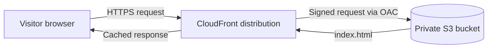

# AWS portfolio site

A single-page portfolio website, hosted as static files in a private Amazon S3 bucket and delivered over HTTPS by Amazon CloudFront.

**Live site:** `https://d310i4gkqt43ca.cloudfront.net`

## Overview

This project hosts a static website on AWS without making the storage bucket public. Visitors connect to CloudFront, and CloudFront reads the site files from S3 through an Origin Access Control (OAC). No one can read the bucket directly.

| Item | Value |
|---|---|
| Site type | Static (HTML, CSS, SVG), no server-side code |
| Storage | Amazon S3, general purpose bucket, Block Public Access on |
| Delivery | Amazon CloudFront, default `*.cloudfront.net` domain and certificate |
| Access control | CloudFront Origin Access Control (OAC) |
| Entry file | `index.html` (set as the CloudFront default root object) |
| AWS account | Free account, with a zero-spend budget alert |

## Architecture



**Request flow**

1. The visitor requests `https://d310i4gkqt43ca.cloudfront.net/`.
2. CloudFront rewrites the request path `/` to `/index.html`, using the default root object setting.
3. If the file is not in the CloudFront cache, CloudFront requests it from S3. The request is signed with SigV4 through the OAC.
4. S3 checks the bucket policy, which allows reads only from this CloudFront distribution, and returns the file.
5. CloudFront caches the file and returns it to the visitor.

## Security design

| Decision | Reason |
|---|---|
| **Block all public access** is enabled on the bucket | Prevents any public read through the S3 URL |
| CloudFront uses **OAC** to read the bucket | The bucket policy grants `s3:GetObject` only to the CloudFront service principal, scoped to this distribution's ARN |
| AWS WAF is not enabled | A static, read-only site has no forms or APIs to protect, and WAF adds cost |
| Daily work uses an **IAM user**, not the root user | Limits the impact of a leaked credential. The root user is reserved for account-level settings |
| Zero-spend budget alert | Sends an email when charges exceed $0, so forgotten resources are caught early |

## Repository structure

```
aws-portfolio-site/
├── .github/
│   └── workflows/
│       └── deploy.yml   # GitHub Actions: deploys on every push to main
├── index.html           # The entire site: markup, styles, and inline SVG
└── README.md            # This file
```

## Deploy manually

Use these steps to deploy from scratch.

### 1. Create the bucket

1. Open **S3** in the AWS console and choose **Create bucket**.
2. Select **General purpose** and enter a globally unique, lowercase bucket name.
3. Keep **Block all public access** selected.
4. Choose **Create bucket**.
5. Open the bucket, choose **Upload**, add `index.html`, and choose **Upload**.

### 2. Create the CloudFront distribution

1. Open **CloudFront** and choose **Create distribution**.
2. Set **Origin type** to **Amazon S3** and select your bucket.
3. Select the option that allows private S3 bucket access to CloudFront (Origin Access Control). Accept the bucket policy update that AWS offers.
4. Do not enable AWS WAF.
5. Choose **Create distribution**.
6. Open the distribution, go to **General → Settings → Edit**, set **Default root object** to `index.html`, and choose **Save changes**.

### 3. Verify

Wait until the distribution status changes from **Deploying** to a date. Then run:

```bash
curl -I https://d310i4gkqt43ca.cloudfront.net
```

The first line of the output must be `HTTP/2 200`. Open the same URL in a browser to confirm the page renders.

To confirm the bucket is private, request a file directly from S3:

```bash
curl -I https://biodun-portfolio-site-2026.s3.eu-west-2.amazonaws.com/index.html
```

The response must be `HTTP/1.1 403 Forbidden`.

## Update the site

Deployment is automated. To publish a change:

1. Edit `index.html` locally.
2. Commit and push to the `main` branch:
   ```bash
   git add index.html
   git commit -m "Describe the change"
   git push
   ```
3. Open the repository's **Actions** tab and wait for the **Deploy to S3 and CloudFront** run to finish with a green check.
4. Reload the site. Allow up to 2 minutes for the CloudFront cache invalidation to complete.

## Automated deployment

The workflow in `.github/workflows/deploy.yml` runs on every push to `main`.

| Step | What it does |
|---|---|
| Check out repository | Copies the repository files to the runner |
| Assume AWS role through OIDC | Exchanges a GitHub-issued identity token for temporary AWS credentials |
| Upload `index.html` to S3 | Runs `aws s3 cp` to overwrite the object in the bucket |
| Invalidate CloudFront cache | Runs `aws cloudfront create-invalidation` with the path `/*` |

**Authentication.** The workflow uses OpenID Connect (OIDC). No AWS access keys are stored in GitHub.

- An IAM identity provider trusts tokens issued by `token.actions.githubusercontent.com`.
- The IAM role `github-actions-portfolio-deploy` has a trust policy that accepts tokens only from this repository's `main` branch.
- The role's permissions policy is limited to `s3:ListBucket`, `s3:PutObject`, and `s3:DeleteObject` on this bucket, and `cloudfront:CreateInvalidation` on this distribution.

## Limitations

- **Single-file deployment.** The workflow uploads only `index.html`. Adding more site files requires changing the upload step to `aws s3 sync` with an exclude list, so `README.md` and `.github/` are not published.
- **Default domain.** The site uses the `*.cloudfront.net` domain. A custom domain requires a Route 53 hosted zone or an external DNS provider, plus an AWS Certificate Manager certificate in `us-east-1`.
- **Root path only.** The default root object applies only to `/`. A request to `/folder/` does not return `/folder/index.html`. This does not affect a single-page site.
- **No infrastructure as code.** Resources were created in the console and are not yet defined in a template.

## Roadmap

- [x] Automate deployment with GitHub Actions and OIDC.
- [ ] Add a custom domain with Route 53 and ACM.
- [ ] Define the S3 bucket and CloudFront distribution in Terraform or AWS CDK.

## What I learned

- **Default root object.** S3 has no home page behavior. CloudFront must map `/` to `/index.html`, or the root URL returns an error.
- **Origin Access Control.** The bucket stays private, and the bucket policy trusts one CloudFront distribution instead of the public.
- **Billing access for IAM users.** IAM users cannot view billing pages until the root user turns on **IAM user and role access to Billing information** in the account settings.
- **Cache invalidation.** Uploading a new file to S3 does not update what CloudFront serves until the cached copy is invalidated or expires.
- **OIDC subject claim.** My first trust policy used `repo:<owner>/<repo>:ref:refs/heads/main`, and AWS rejected the role assumption with `Not authorized to perform sts:AssumeRoleWithWebIdentity`. I added a temporary workflow step that printed the token's `sub` claim and found that GitHub sent `repo:<owner>@<owner-id>/<repo>@<repo-id>:ref:refs/heads/main`. Updating the trust policy to that exact value fixed it.
- **Least-privilege debugging.** The next failure was `AccessDenied` on `cloudfront:CreateInvalidation`. The error message named the exact action and resource, which pointed to the ARN in the permissions policy.

## Author

BioDun, frontend developer.

- GitHub: [KaTaBioDun](https://github.com/KaTaBioDun)
- LinkedIn: [hammed-arogundade](https://www.linkedin.com/in/hammed-arogundade-62b350255/)
- Email: arohammed0.1@gmail.com
